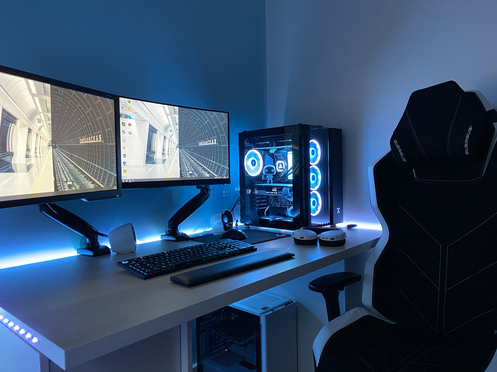

<h1 align="center">Hi, I'm Vassili 👋</h1>

  

  

## 🙋 About me

- 💼 **CEO** of [The Forge Agency](https://the-forge.agency), a digital agency building custom web apps, SaaS and scraping tools
- 🧾 **CTO** of [TaxCut](https://www.taxcut.fr/), AI-powered tax filing for French taxpayers
- 🚀 Building at **Station F**, Paris 🇫🇷
- 🎓 Self-taught full-stack developer, coding with Laravel every day, fueled by coffee ☕

## 🌟 Featured projects

<table>
  <tr>
    <td width="50%" valign="top">
      

        
      

      <h3 align="center"><a href="https://github.com/vassilidev/TermF">TermF</a></h3>
      
<b>Talk only to the CTO.</b>

      

        A free desktop app for Claude Code. You describe the work to one agent, the CTO; a team of 29 AI agents plans it, codes it, tests it and reviews it, then brings you a pull request to approve. All your Claude Code, Codex and Gemini sessions in one window, with Git, CI/CD, a vault and encrypted sync around them.
      

      <a href="https://github.com/vassilidev/TermF">
        <picture>
          <source media="(prefers-color-scheme: dark)" srcset="https://raw.githubusercontent.com/vassilidev/TermF/main/site/shots/home-dark.webp" />
          
        </picture>
      </a>
      

        Rust · Tauri · Svelte · macOS, Windows, Linux · local-first, no account, no telemetry 
        <a href="https://vassilidev.github.io/TermF/"><b>Website</b></a> · <a href="https://vassilidev.github.io/TermF/download.html"><b>Download</b></a> · <a href="https://github.com/vassilidev/TermF">Source</a>
      

    </td>
    <td width="50%" valign="top">
      

        
      

      <h3 align="center"><a href="https://github.com/vassilidev/evict">Evict</a></h3>
      
<b>The bouncer for your disk.</b>

      

        A free, open-source disk space analyzer. It scans the whole disk in seconds (5.7 million files in about 20 seconds on a Mac) and draws it as a treemap, then finds large files, duplicates and developer caches like <code>node_modules</code> and cleans them up safely, through the Trash.
      

      
      

        C · SwiftUI · GTK · WebView2 · native on macOS, Windows, Linux · no account, no telemetry 
        <a href="https://vassilidev.github.io/evict/"><b>Website</b></a> · <a href="https://vassilidev.github.io/evict/download.html"><b>Download</b></a> · <a href="https://github.com/vassilidev/evict">Source</a>
      

    </td>
  </tr>
</table>

## 🔨 What I'm building

- 🗓️ **[#TFA52](https://tfa52.app)**: 52 apps in 52 weeks, picked by the community. [WhoseTurn](https://github.com/The-Forge-Agency/WhoseTurn), [GiftSwipe](https://github.com/The-Forge-Agency/GiftSwipe), [ColorPalette4Me](https://github.com/The-Forge-Agency/ColorPalette4Me), [Jsonaut](https://github.com/The-Forge-Agency/JsonautApp), [Bannr](https://github.com/The-Forge-Agency/BannrApp), [imgk](https://github.com/The-Forge-Agency/ImgkApp), [LeMur](https://github.com/The-Forge-Agency/LeMur), [Tsecret](https://github.com/The-Forge-Agency/TSecret) and more
- 🧠 **[Mnemo](https://github.com/The-Forge-Agency/Mnemo)**: persistent, cross-machine memory for your AI coding assistant
- 🔗 **[UnLink](https://github.com/The-Forge-Agency/unlink)**: a Chrome extension that clears LinkedIn prospecting spam in one click

## 🛠️ Tech stack

  

Also: Filament · Livewire · Pest · React Native & Expo · shadcn/ui · Claude, OpenAI & Mistral APIs · Playwright & Puppeteer

## 📊 GitHub stats

  
  

  

  <picture>
    <source media="(prefers-color-scheme: dark)" srcset="https://raw.githubusercontent.com/vassilidev/vassilidev/output/github-snake-dark.svg" />
    
  </picture>

## 💻 My setup

  

